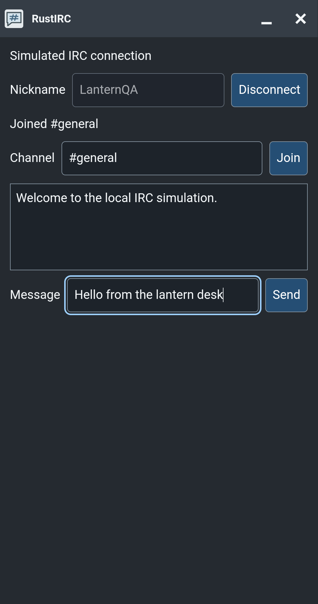
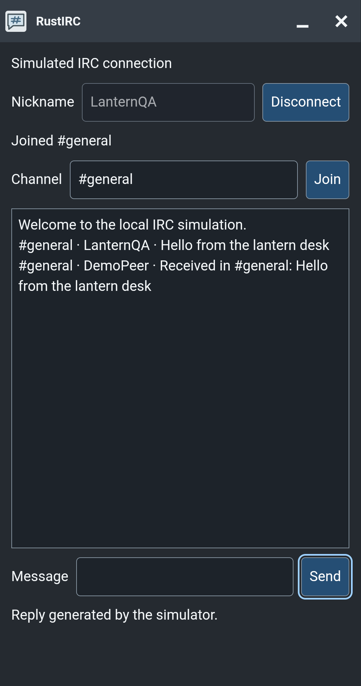

# RustIRC on the Galaxy S10+

Open **System Tools → RustIRC**. Type `LanternQA`, connect and join
`#general`. Send `Hello from the lantern desk`. The browser simulation
shows both the sent line and `DemoPeer`'s matching reply. Join `#writing`
and send `Second room is ready`. Disconnect to reset the active channel.

The browser app loads for guests and signed-in users. Its simulator generates
the replies and keeps the transcript in its window. The full native IRC
client and live IRC server access are outside the hosted workflow.

## Verification

The S10+ in Chrome 158.0.8127.92 and Chromium 158.0.8127.36 at 820 and 1300
CSS pixels passed four of five workflow groups.

- Connect, reject an invalid nickname, disconnect and reconnect.
- Join valid channels and recover from an invalid name.
- Send exact messages and receive simulated replies in two channels.
- Minimize the app and return to the launcher.

Independent simultaneous windows are the remaining group. Four groups exceed
the one-group phone baseline and meet the 80% desktop simulator target. The
simulation has no editable file save or export.

The keyboard reduced the phone viewport to 417 CSS pixels in the hosted
replay. The message field and the 44-CSS-pixel Send button stayed visible.
The transcript measured 14.59:1 contrast in dark mode. The hosted result
also confirmed the server's expected simulator response, which the app
presents as “Reply generated by the simulator.”

The separate loopback browser test passed registration, PING/PONG, JOIN,
both message directions, double disposal and TCP closure. It exercises
the browser protocol adapter with a local fixture.

## Source and deployment

Runtime source is `a192061447538e0bd525d0eee3713dab32673a39`. The WebOS viewer packages
`webos-demo.mjs` as `index.mjs` alongside `app.mjs`, `webos.css` and
`demo/transport.mjs`. The verified live viewer is
`2af400c3519e6cbecafa5ed6bd22586d27825dbb946eb1b214a05756fa52eaa7`.

See [WebOS integration](../../WEBOS.md) and the
[production release and rollback](https://github.com/CC-David-CC/WebOS/blob/webos/rustirc-phone-simulation/deploy/ACTIVE-RELEASE.md#rustirc-phone-simulator-and-dark-transcript).
